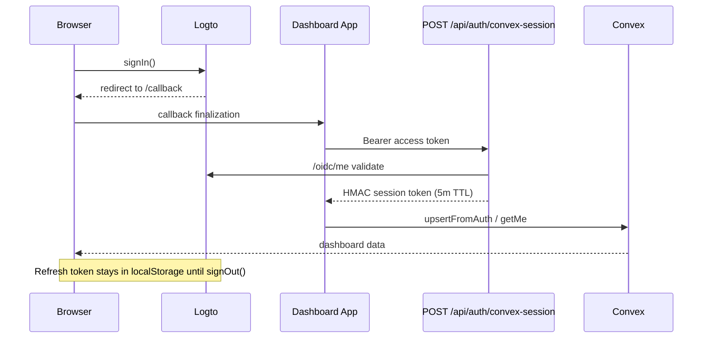

# Dashboard Auth Runbook

The dashboard has one auth path:

1. **Logto** owns the browser session (Google OIDC, refresh token in `localStorage`).
2. The app mints a short-lived **HMAC Convex bridge token** from a validated Logto access token (`POST /api/auth/convex-session`).
3. Convex queries/mutations receive `{ logtoId, authToken }` and verify the HMAC token.
4. Roles and access come from the Convex `users` document, not Logto claims.

This exists because Logto Cloud defaults to **ES384** ID tokens, which Convex cannot verify. Switching Convex to native JWT auth would require rotating Logto private keys to RSA/ES256 and rewriting every Convex function signature — that is out of scope here.

`convex/auth.config.ts` stays in place for self-hosted Convex deploy-time issuer checks. It is not used for the dashboard session.

## Required Settings

### App container

- `LOGTO_ENDPOINT` (Logto base URL, e.g. `https://auth.example.com`)
- `VITE_LOGTO_ENDPOINT`
- `VITE_LOGTO_APP_ID`
- `VITE_LOGTO_REDIRECT_URI`
- `VITE_LOGTO_SCOPES`
- `VITE_CONVEX_URL`
- `CONVEX_SESSION_SECRET` (must match Convex)

### Convex deployment

- `LOGTO_ENDPOINT` + `LOGTO_APP_ID` (needed at deploy time by `auth.config.ts`)
- `CONVEX_SESSION_SECRET` (must match the dashboard)

## Flow

## Validation Checklist

1. Confirm app + Convex both have matching Logto app id and endpoint.
2. Confirm `CONVEX_SESSION_SECRET` matches on the app and Convex deployment.
3. Validate login, hard refresh, browser restart, stale `/callback`, logout, and account switch.
4. Confirm no flow requires clearing cookies or local storage except explicit Sign out.

## Failure Triage

- `reason=stale-callback`: browser callback state drifted; the app clears local SDK tokens and retries.
- `reason=session-init`: bootstrap failed after bounded retry. The app preserves the Logto refresh token when it still works and re-bootstraps once before offering another OAuth login.

## Evidence To Capture In Staging

- browser HAR
- browser storage snapshot (`logto:*:refreshToken` present after refresh)
- app logs filtered by `type=auth_event`
- Logto auth event logs
- Convex logs around identity resolution and user lookup

## Secrets

- Never expose `LOGTO_M2M_APP_SECRET` or `CONVEX_SESSION_SECRET` in client-visible env vars.
- `VITE_LOGTO_APP_SECRET` must remain unset.
- Rotate any previously exposed local secrets before production rollout.
